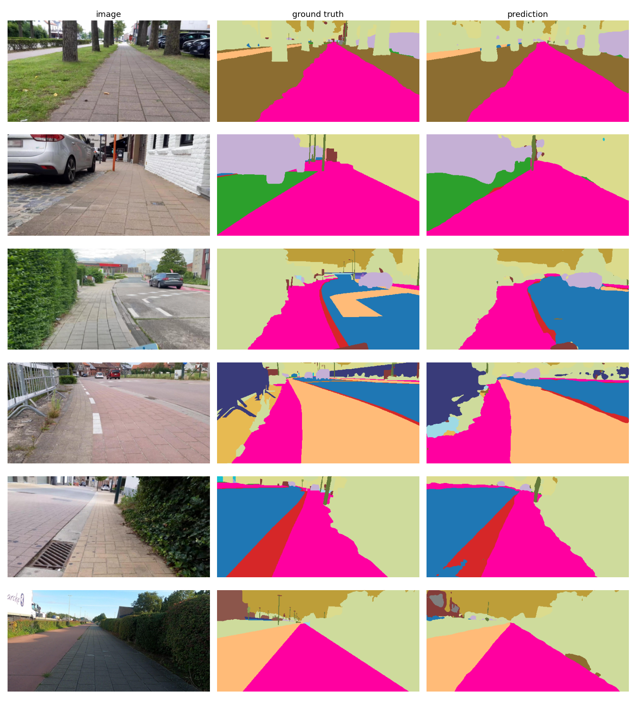

# Sidewalk semantic segmentation (U-Net, PyTorch)

Semantic segmentation of street-level photos into 34 classes (road, **sidewalk**, crosswalk, curb, car, person, building,
vegetation, ...) on the [segments/sidewalk-semantic](https://huggingface.co/datasets/segments/sidewalk-semantic) dataset.
Two models are compared: a **U-Net written from scratch** and a **U-Net with a pretrained ResNet-34 encoder**.

## Results

Test split: 100 images never used for training or model selection (256×512 px). The best epoch was chosen by validation mIoU.

| Model | Epochs | Best val mIoU | Test mIoU | Test pixel acc. | Test sidewalk IoU |
|---|---|---|---|---|---|
| U-Net (from scratch) | 60 | 27.7% | 25.5% | 81.3% | 83.4% |
| U-Net + ResNet-34 encoder (ImageNet-pretrained) | 40 | 35.0% | 33.2% | 86.8% | 89.4% |

Training curves, per-class IoU and sample predictions are in `results/unet/` and `results/resnet34_unet/`.

**Takeaways**
- The pretrained encoder gives about +7.7 mIoU points and +6 points of sidewalk IoU with fewer epochs, i.e. transfer learning matters a lot with only 800 training images.
- The sidewalk class, the focus of this project, is segmented well by both models (83% and 89% IoU). Overall mIoU is low mainly because of rare and thin classes (poles, signs, etc.), which have few training examples.
- Both models overfit moderately (the ResNet-34 model reaches train loss 0.18 vs. val loss 0.60), and the val/test sets contain only 100 images each, so small differences between runs are within noise; the gap between the two models is large enough to be meaningful.

### Per-class IoU (test, %, selected classes)

| Class | U-Net | ResNet-34 U-Net |
|---|---|---|
| sidewalk | 83.4 | 89.4 |
| road | 62.9 | 73.2 |
| cyclinglane | 57.2 | 71.5 |
| curb | 41.6 | 56.1 |
| crosswalk | 21.1 | 36.7 |
| parkingdriveway | 29.2 | 42.8 |
| car | 78.7 | 86.2 |
| person | 42.3 | 64.1 |
| bicycle | 4.3 | 38.4 |
| building | 68.0 | 75.8 |
| vegetation | 83.1 | 85.9 |
| terrain | 73.4 | 77.7 |
| sky | 92.1 | 93.7 |
| pole | 26.2 | 42.8 |
| fenceguardrail | 14.4 | 44.6 |

Full table: `results/*/per_class_iou.md`. Classes absent from the test split (`railtrack`, `caravan`) are excluded from mIoU. The ResNet-34 model scores 0% IoU on 12 classes (rider, truck, bus, tramtrain, motorcycle, cartrailer, bridge, tunnel, stairs, trafficsign, trafficlight, unclear); most of these are rare in the dataset, so the model rarely or never predicts them. These zeros are what keeps mIoU at about 33% while sidewalk IoU is 89%. Class-balanced loss or more data would be the next step.



Samples are the first 6 test images (not hand-picked): image, ground truth, prediction (sidewalk is pink).

**Limitations:** single run, single seed, no hyperparameter tuning, low resolution (256×512).

## Dataset

1,000 photos of sidewalks and roads (the dataset ships a single split, so I split it 80/10/10 with a fixed seed:
800 train / 100 val / 100 test). Labels are per-pixel class IDs; ID 0 (`unlabeled`) is ignored in the loss and in the metrics.
The dataset is gated and licensed **CC BY-NC 4.0** (non-commercial); it is not included here.

## Method

- **Input:** images resized to 256x512 (bilinear), ImageNet normalisation. Cached once as `.npz` so epochs are fast.
- **Masks:** resized with **nearest-neighbour** and kept as integer class IDs. (Resizing them bilinearly and dividing by 255,
  as in my first attempt, mixes class IDs into meaningless values: the model then cannot learn anything useful.)
- **Augmentation (train only):** horizontal flip (applied to image and mask together), random brightness/contrast.
- **Models:** `unet`: classic U-Net (4 down/up blocks, BatchNorm); `resnet34_unet`: ResNet-34 (ImageNet) encoder with a U-Net decoder.
- **Loss / optimiser:** cross-entropy with `ignore_index`, AdamW, one-cycle LR schedule, mixed precision on GPU.
- **Metrics:** mean IoU over classes present in the split, pixel accuracy, IoU of the `sidewalk` class. The checkpoint with the
  best **validation** mIoU is evaluated once on the **test** split.

## Run it

Easiest: open `notebooks/train_colab.ipynb` in Google Colab (free GPU). Locally:

```bash
pip install -r requirements.txt
huggingface-cli login                       # accept the dataset conditions on Hugging Face first
python src/train.py --model resnet34_unet --epochs 40
python src/evaluate.py --ckpt checkpoints/best.pt
pytest                                      # checks the pipeline on synthetic data, no dataset needed
```

`python src/train.py --data synthetic --epochs 2` runs the whole training loop on generated data to check the code.

## Layout

```
src/classes.py    class names, ignore index
src/data.py       loading, caching, split, augmentation
src/model.py      UNet, ResNetUNet
src/metrics.py    confusion matrix, IoU, pixel accuracy
src/train.py      training loop, checkpointing, curves
src/evaluate.py   test metrics, per-class IoU chart, example predictions
tests/            tests of mask handling, metrics, shapes and a full train/evaluate cycle
notebooks/        Colab notebook
```
